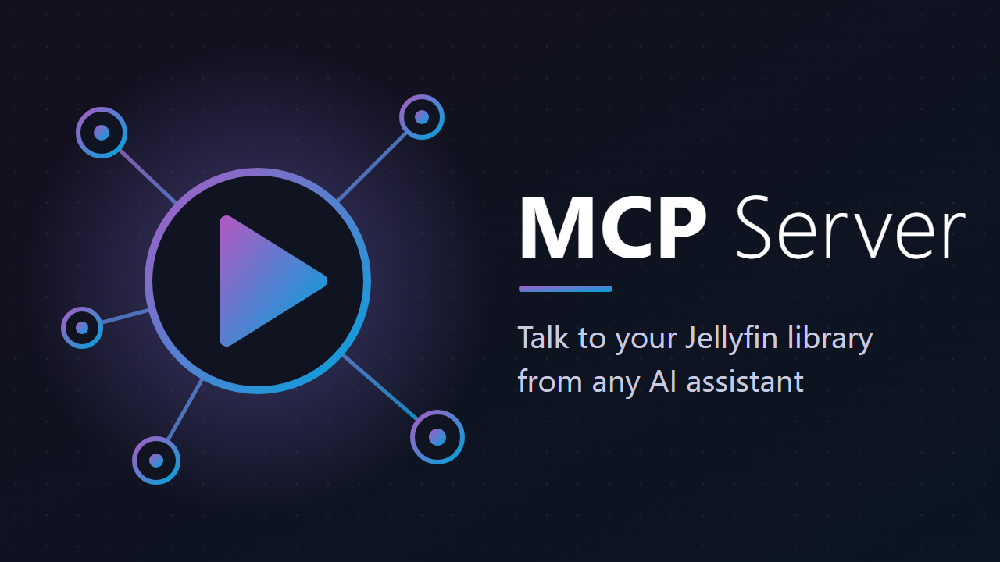

# Jellyfin MCP Server plugin



A Jellyfin plugin that exposes your server to AI assistants through the [Model Context Protocol](https://modelcontextprotocol.io) (MCP). Assistants such as Claude can search and browse your library, see what you are watching, control playback on your devices, manage playlists and favorites, and (for administrators) run server tasks. Every call runs as the Jellyfin user who owns the access token, limited to that user's permissions and to the scopes granted to the token. The plugin has no runtime dependencies besides Jellyfin itself.

## Compatibility

- Jellyfin **12.x** only (compiled against 12.4.0, `targetAbi` 12.4.0.0). Older servers are not supported.
- Built with .NET 10.
- MCP transport: Streamable HTTP, stateless, `POST /mcp`. Protocol revisions 2025-11-25, 2025-06-18 and 2025-03-26. The stateless 2026-07-28 revision is not supported yet (see the [roadmap](docs/roadmap.md)).
- Clients that send a static `Authorization: Bearer` header work; Claude Code is the supported client. Claude Desktop through `mcp-remote` is expected to work but is not yet verified. claude.ai web connectors need OAuth and are not supported yet.

## Install in three steps

1. In Jellyfin go to **Dashboard > Plugins > Repositories > +** and add `https://raw.githubusercontent.com/AeLui/jellyfin-plugin-mcp/main/manifest.json`.
2. Open the **Catalog**, install **MCP Server** and restart Jellyfin.
3. Open **Dashboard > Plugins > MCP Server**, create a token (pick the user and the scopes) and copy it. It is shown only once.

More detail, including a manual install, is in [docs/installation.md](docs/installation.md).

## Connect a client

Replace `https://jellyfin.example.com` with your server address and `jmcp_...` with your token.

Claude Code, with the plugin from this repository's marketplace (connects the server and adds the [agent skill](#agent-skill); it asks for the URL and the token, and keeps the token in your system's credential store):

```
/plugin marketplace add AeLui/jellyfin-plugin-mcp
/plugin install jellyfin-mcp@jellyfin-plugin-mcp
```

On Claude Code 2.1.275 or later, one step is enough: `/plugin install jellyfin-mcp --marketplace AeLui/jellyfin-plugin-mcp`. To change the URL or token later, run `/plugin configure jellyfin-mcp@jellyfin-plugin-mcp`.

Claude Code, server only:

```bash
claude mcp add --transport http jellyfin https://jellyfin.example.com/mcp \
  --header "Authorization: Bearer jmcp_..."
```

Claude Desktop (`claude_desktop_config.json`; requires [Node.js](https://nodejs.org) because it runs `npx mcp-remote`):

```json
{
  "mcpServers": {
    "jellyfin": {
      "command": "npx",
      "args": ["-y", "mcp-remote", "https://jellyfin.example.com/mcp",
               "--header", "Authorization: Bearer jmcp_..."]
    }
  }
}
```

The token dialog in the plugin page generates both snippets for you. The Claude Desktop flow is expected to work but has not been verified against a live server yet.

## Scopes and tools

22 tools in four scopes. A token only sees the tools its scopes allow.

| Scope | Tools | Purpose |
|---|---|---|
| `library` | 9 | Read-only: search, browse, details, people, recent, next up, continue watching, history |
| `playback` | 4 | List sessions, play, control playback, show a message |
| `manage` | 4 | The user's own watch state and favorites, plus playlists the user owns or may edit |
| `admin` | 5 | Users, scheduled tasks, library scan, metadata refresh (administrators only) |

Full reference: [docs/tools.md](docs/tools.md).

## Agent skill

[skills/jellyfin-mcp/SKILL.md](skills/jellyfin-mcp/SKILL.md) is an optional [Agent Skill](https://agentskills.io) that teaches an assistant when and how to use these tools: getting ids before acting, picking a playback session, paging, and asking before destructive actions.

The Claude Code plugin above includes it. Other agents: copy the `skills/jellyfin-mcp` folder into their skills directory (for Claude Code without the plugin, `~/.claude/skills/` or `.claude/skills/` in a project). If you install the plugin, remove any server you added with `claude mcp add`, or the tools show up twice.

## Privacy

The plugin runs inside your Jellyfin server and makes no outbound connections. The Claude Code plugin connects only to the Jellyfin URL you configure. What your assistant does with the tool results is governed by the assistant's own privacy policy.

## Documentation

- [Installation and client setup](docs/installation.md)
- [Tool reference](docs/tools.md)
- [Security model](docs/security.md) - read this before exposing the endpoint beyond your LAN
- [Architecture](docs/architecture.md)
- [Development](docs/development.md)
- [Roadmap](docs/roadmap.md)

## Support the project

The plugin is free and open source. If it is useful to you, you can support its development through [GitHub Sponsors](https://github.com/sponsors/AeLui).

## License

GPL-3.0, see [LICENSE](LICENSE).
